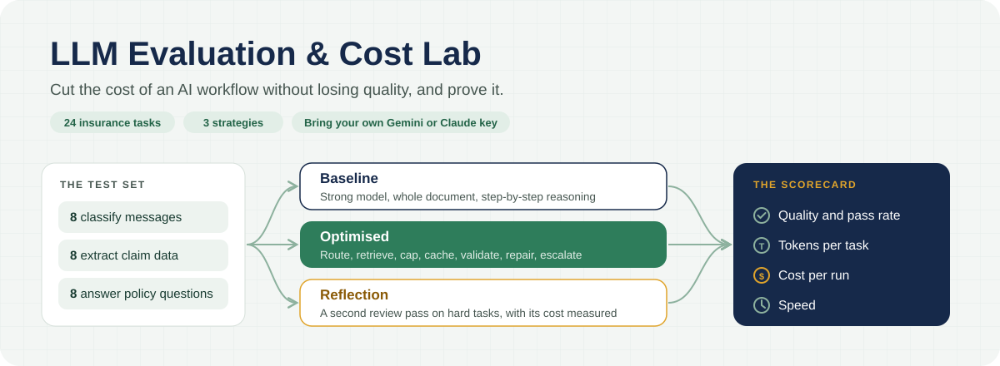
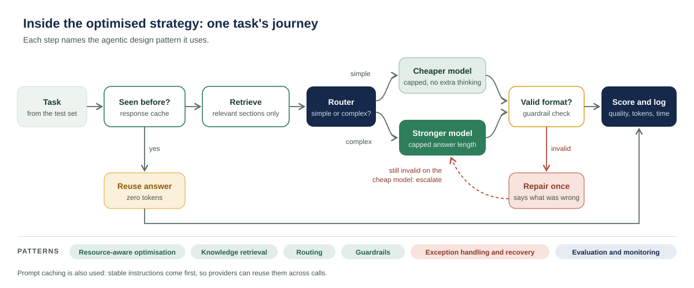

<p align="center">
  
</p>

<p align="center">
  
  
  
  
  <a href="https://colab.research.google.com/github/YOUR-USERNAME/llm-evaluation-and-cost-lab/blob/main/notebooks/colab_quickstart.ipynb"></a>
</p>

> **One question drives this project:** can an AI workflow cost less without getting worse? This lab measures the answer instead of guessing it.

## What it does

- It gives an AI model **24 realistic insurance tasks**: sorting customer messages, pulling claim details out of emails, and answering questions from a policy document.
- It runs every task **three ways**, from a full-strength reference setup to a carefully optimised one.
- It **scores every answer** against the correct one, and records tokens, cost and time for every call.
- It produces a **report** comparing the strategies side by side, and shows exactly which technique saved what.

## Why it matters

The cost of an AI workflow is shaped by design choices: which model handles each task, how much context it receives, and how long its answers are. The same choices shape quality. Changing one without measuring the other is a guess. A cheaper setup can quietly start getting answers wrong, and a more expensive one may add nothing.

Two numbers are needed before anything changes: **a quality score** you can trust, and **the cost of each task**. This lab produces both, so every saving is checked against quality.

## The three strategies

| Technique | Baseline | Optimised | Reflection |
|---|:---:|:---:|:---:|
| Strongest model for every task | ✓ | | ✓ |
| Cheaper model for simple tasks | | ✓ | |
| Whole policy document sent as context | ✓ | | |
| Only the relevant policy sections sent | | ✓ | ✓ |
| Long instructions with step-by-step reasoning | ✓ | | |
| Short, stable instructions and capped answers | | ✓ | ✓ |
| Repeated questions answered from a cache | | ✓ | |
| Format checks, one repair, then escalation | | ✓ | |
| Second review pass on hard tasks | | | ✓ |

- **Baseline** gives every task the strongest model, the full document and detailed reasoning. It is the reference point the other strategies are measured against.
- **Optimised** combines every saving technique, with checks that protect quality.
- **Reflection** tests a popular quality technique, and measures whether its extra cost is worth it.

## Inside the optimised strategy

<p align="center">
  
</p>

1. **Response cache.** If the same request was answered before, the stored answer is reused at zero token cost.
2. **Retrieval.** For policy questions, only the two most relevant sections of the policy are sent, not the whole document.
3. **Router.** Simple rules send simple tasks to the cheaper model and complex ones to the stronger model. The rules never see the difficulty labels, so the report can measure how often the router chose well.
4. **Model call.** Instructions are short and placed first, so providers can cache them. Answer length is capped for each task type.
5. **Guardrail.** Every output is checked against the required format and allowed values.
6. **Repair, then escalate.** An invalid output gets one repair attempt, with a message saying what was wrong. If a cheap model still fails, the task moves to the stronger model.
7. **Score and log.** The answer is scored, and tokens, cached tokens, retries and time are recorded.

## The test set

All data is fictional. The policy document and every task were written for this project. Meridian Home Insurance is not a real company.

| Task type | Easy | Hard | What it checks |
|---|:---:|:---:|---|
| Classify a customer message | 6 | 2 | One of six categories, such as claim, complaint or cancellation |
| Extract claim details into JSON | 5 | 3 | Policy number, incident date, claim type and amount, from messy emails |
| Answer a policy question | 5 | 3 | Exact figures from the policy, and a refusal when the policy is silent |

<details>
<summary><b>See an example of each task type</b></summary>

**Classify.** *"I've been waiting three weeks for my claim to be paid and nobody replies to my emails. I want to escalate this."* Expected: `complaint`. It mentions a claim, so it is a hard task.

**Extract.** *"Hi, it's about my home cover (the number is MHI 772 913, sorry for the spaces). On Saturday the 18th of April 2026 we found the back door forced open and my bicycle gone. The bike was about two thousand three hundred dollars."*
Expected:
```json
{"policy_number": "MHI-772913", "incident_date": "2026-04-18", "claim_type": "theft", "estimated_amount": 2300}
```

**Answer.** *"I was travelling for 70 days in a row and my house was burgled while I was away. Am I covered?"* Expected: not covered, because the policy excludes loss while the home is unoccupied for more than 60 days in a row.

</details>

## How quality is scored

| Task type | Scoring rule |
|---|---|
| Classify | Correct only if the category matches exactly. |
| Extract | Partial credit: each of the four fields is checked, so a score of 0.75 means three of four were right. |
| Answer | Every required fact must appear, such as the right amount or time limit. Refusal questions must be refused. |

A task **passes** when it scores 1.0. Scoring is done in code, not by another model, so every score can be audited and no extra tokens are spent on grading.

## What the report shows

Each run writes a report to `results/<run-id>/report.md`:

- **A scorecard per strategy:** quality, pass rate, number of calls, input, output and cached tokens, tokens per task, cost and average time.
- **Optimised against baseline:** the change in tokens per task, quality, cost and speed.
- **The reflection experiment:** whether the second pass bought enough quality for its extra cost.
- **What each optimisation did:** how many tasks went to each model, how often the router agreed with the difficulty labels, cache hits, repairs and escalations.
- **Quality by task type**, so a saving that hurts one kind of task cannot hide in an average.

## Results

Results will be published here after the first full run on a real model, with the run report linked. Until then, this section is intentionally empty: no numbers are shown that were not measured.

## Agentic design patterns used

| Pattern | Where it appears |
|---|---|
| Evaluation and monitoring | Automatic scoring and per-call logging (`lab/scoring.py`, `lab/runner.py`) |
| Resource-aware optimisation | Routing, retrieval, output caps, response cache and prompt caching |
| Routing | Rule-based router choosing the cheaper or stronger model (`route` in `lab/runner.py`) |
| Knowledge retrieval | Selecting relevant policy sections (`retrieve` in `lab/prompts.py`) |
| Reflection | Second review pass on hard tasks (`reflection` strategy) |
| Reasoning techniques | Step-by-step reasoning in the baseline against direct answers, compared on quality and cost |
| Guardrails | Format and allowed-value checks before an answer is accepted (`validate` in `lab/scoring.py`) |
| Exception handling and recovery | Retries with backoff for rate limits, one repair attempt, escalation to the stronger model |

## Design decisions and trade-offs

- **Tokens first, cost second.** Prices change and differ by provider, so tokens are always reported. Cost is calculated when prices are added to `config.py`.
- **Code-based scoring.** Exact checks are cheaper, faster and auditable. Open-ended answers would need a model-based judge, which is on the roadmap.
- **An honest router.** It decides from the task text alone, so its accuracy is a real measurement.
- **Repair before escalate.** A repair on the cheap model usually costs less than a call to the stronger one, so it is tried first.
- **Fictional data only.** Free tiers may use inputs to improve their models, so no real customer or company data is ever used.

## Quick start

**In Google Colab, with nothing to install:** click the **Open in Colab** badge above, add your key under Secrets, and run the cells.

**On your own machine:**

```bash
pip install -r requirements.txt
export GEMINI_API_KEY=your-key          # free key from aistudio.google.com
python run.py --limit 6                  # quick check on the first 6 tasks
python run.py                            # all three strategies on all 24 tasks
python run.py --provider anthropic       # use Claude instead, with ANTHROPIC_API_KEY set
python run.py --provider mock            # offline dry run to test the pipeline only
```

Models, prices, answer caps and the pause between calls are set in `config.py`. To add another provider, add a class with a `generate` method in `lab/providers.py`.

## Repository structure

```
llm-evaluation-and-cost-lab/
├── run.py                 Runs the strategies and writes the report
├── config.py              Provider, models, prices, caps and rate-limit settings
├── lab/
│   ├── providers.py       Gemini, Claude and offline mock, with retries
│   ├── prompts.py         Prompts for each strategy, and retrieval
│   ├── runner.py          Router, strategies, cache, repair and escalation
│   ├── scoring.py         Scoring rules and format checks
│   └── report.py          Builds the comparison report
├── data/
│   ├── tasks.jsonl        The 24 tasks with expected answers
│   └── policy.md          The fictional policy document
├── notebooks/
│   └── colab_quickstart.ipynb
├── docs/                  Diagrams used in this README
└── results/               One folder per run, with the report
```

## Limitations

- 24 tasks show the method, not production-grade quality. A real evaluation set would be larger and drawn from anonymised real traffic.
- The routing rules were written alongside this test set. In production they would be tested on unseen data, or replaced by a small classifier.
- Free-tier rate limits make a full run slow, so the lab pauses between calls.

## Roadmap

- A model-based judge for open-ended answers, calibrated against human ratings
- Batch processing for non-urgent work, where providers offer lower prices
- A larger test set covering underwriting and claims
- A simple web dashboard to compare runs over time

## How it was built

Designed by Rashmi Singh: the test set, scoring rules, optimisation strategy and report. The code was written with AI coding tools, then run, tested and reviewed by me.
